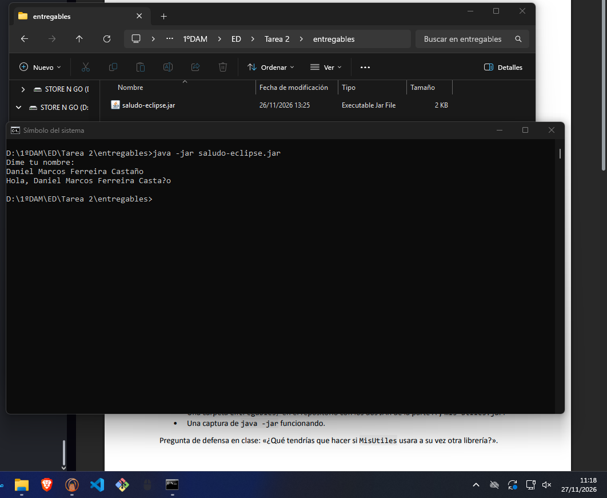
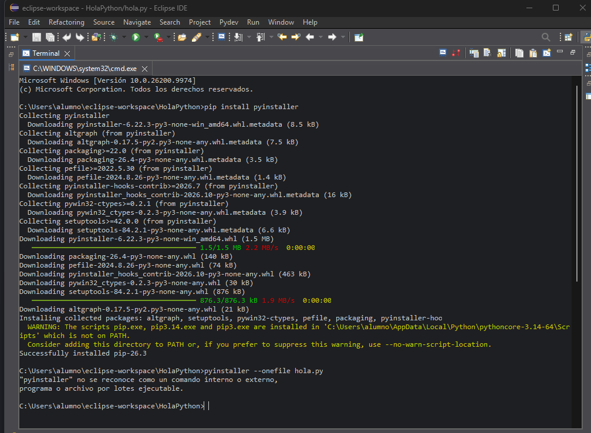

# Tarea 2. Del código al JAR y librería sin Maven

> **Nota:** Siguiendo las indicaciones dadas en clase de trabajar exclusivamente con Eclipse, se incluye únicamente el ejecutable generado desde IDE (`saludo-eclipse.jar`).

## Evidencia de ejecución (`java -jar`)

---

## Parte C: Ejecutable de Python con PyInstaller
Al intentar generar el ejecutable con `pyinstaller --onefile hola.py` desde la terminal integrada de Eclipse, se produce el siguiente error:

**Explicación del error:**  
El comando `pyinstaller` falla porque aunque se ha instalado correctamente mediante `pip`, no esta guardado la ruta del programa en la zona centralizada que tiene windows (path) para consultar/ejecutar dicho programa.

---

## Pregunta de defensa en clase
**«¿Qué tendrías que hacer si `MisUtiles` usara a su vez otra librería?»**  
Como la libreria `MisUtiles` necesita otra libreria para funcionar entonces haria lo mismo que hice en `ProyectoPrincipal`, importando tanto en `mis-utiles.jar` como en el main del proyecto, haciendo un efecto "cadena".